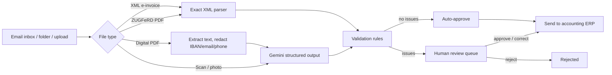

# Invoice Automation Pipeline

An AI system that takes over the most repetitive job in accounts payable: reading incoming invoices and
typing them into the accounting system. It reads PDFs, scans, photos and German e-invoices (XRechnung,
ZUGFeRD), checks every invoice against business rules, sends clean ones to accounting automatically, and
puts only the problem cases in front of a person, with the original document next to the extracted data.

**Why this matters:** since January 2025 every German business must be able to receive e-invoices, but most
invoices still arrive as PDFs and scans by email. Companies need one pipeline that handles both.



## What it does

- **Reads any invoice format.** Structured e-invoices (UBL and CII XML, and ZUGFeRD PDFs with embedded XML)
  are parsed exactly, with no AI and no cost. Digital PDFs and scans are read by Gemini with a strict JSON schema.
- **Checks the data with deterministic rules.** Line items must add up to the net total, and net plus VAT
  must equal the gross total. Supplier VAT IDs are validated, including the official German check digit.
  The pipeline also detects duplicate invoices and matches invoices against purchase orders (amount and
  supplier). It flags unusual VAT rates, dates and currencies too. The LLM reads the document; the rules
  decide whether the result can be trusted.
- **Routes by confidence.** Invoices with no issues are approved and exported automatically. Everything else
  goes to a review queue with the reasons spelled out and the affected fields highlighted.
- **Keeps a human in control.** A reviewer can correct fields and approve, or reject with a reason. Every
  automatic and human action is written to an audit log.
- **Handles production concerns.**
  - Personal and banking data is redacted before text leaves the system.
  - Re-uploads of the same file are deduplicated, using a SHA-256 hash of the file.
  - Gemini calls are rate-limited and retried with backoff.
  - Documents are never lost: if extraction fails, the invoice goes to review.
  - Exports to the accounting system are idempotent, so a retry can't book an invoice twice.
  - The API and the folder/email worker run as separate Docker services on PostgreSQL.
- **Is measured, not assumed.** A labelled dataset of 60 synthetic invoices, with deliberate errors in
  multiple formats, measures extraction accuracy and routing. CI blocks any change that would let a faulty
  invoice be auto-approved.

## Results

| Metric | Value |
|---|---|
| Field-level extraction accuracy | 100% (13 fields, 10 documents including a scanned image; Gemini 3.8 Flash) |
| Routing accuracy (approve vs. review) | 100% |
| Faulty invoices auto-approved | 0 |
| Documents read without any LLM call (XML e-invoices) | 2 of 10 |

Evaluated on the first 10 documents of the 60-document set because of the Gemini free-tier limit of 20 requests
per day; the full set is checked for rules and routing on every commit with the oracle extractor. During the run,
three 503 "high demand" errors from the API were recovered automatically by retry with backoff.

Full report: [evaluation/results/gemini.md](evaluation/results/gemini.md). To reproduce, run
`python -m evaluation.run_eval --extractor gemini` with your API key.

## Quick start

### Local (SQLite)

```bash
python -m venv .venv
source .venv/bin/activate          # Windows: .venv\Scripts\activate
pip install -r requirements-dev.txt
cp .env.example .env               # then add your free Gemini key
uvicorn app.api:app --reload
```

Open http://localhost:8000, and drag files from `evaluation/dataset/docs/` onto the page.
The API documentation is at http://localhost:8000/docs.

Without an API key, the XML e-invoices still work. Everything else goes to the review queue.

### Docker (PostgreSQL, API and background worker)

```bash
cp .env.example .env
docker compose up --build
```

Files dropped into `./inbox/` are picked up by the worker automatically. To also read an email inbox, set
`IMAP_*` in `.env`.

## Tests and evaluation

```bash
pytest                                                              # unit, pipeline and API tests
python -m evaluation.run_eval --extractor oracle                    # rules + routing with perfect extraction
python -m evaluation.run_eval --extractor gemini                    # real LLM accuracy
python -m evaluation.generate_dataset --n 100 --seed 42 --out /tmp/new-set   # a fresh test set
```

The test set includes:
- clean invoices
- line items that don't add up
- wrong totals
- fake VAT IDs
- duplicates
- unknown or mismatched purchase orders
- delivery notes sent by mistake

It covers German and English, three layouts, and five formats: digital PDF, scan, UBL XML, CII XML and
ZUGFeRD PDF.

## API

| Method | Path | Purpose |
|---|---|---|
| POST | `/api/documents` | Upload one or more files |
| GET | `/api/invoices?status=needs_review` | List invoices |
| GET | `/api/invoices/{id}` | Details, line items, issues, history |
| GET | `/api/invoices/{id}/file` | The original document |
| POST | `/api/invoices/{id}/approve` | Approve, optionally with corrections |
| POST | `/api/invoices/{id}/reject` | Reject with a reason |
| GET | `/api/stats` | Throughput, auto-approval rate, top issues |
| GET | `/api/export.csv` | Excel-ready CSV (German format) |

## Project structure

```
app/
  api.py              REST API + review UI
  pipeline.py         extract -> validate -> route -> export
  validation.py       business rules (pure functions, unit-tested)
  extraction/
    xml_einvoice.py   XRechnung (UBL) and ZUGFeRD (CII) parser
    llm.py            Gemini extraction with schema, retries, rate limit
    pdf.py            text layer + embedded XML detection
  redaction.py        PII removal before LLM calls
  erp.py              export to accounting (mock outbox or webhook)
  models.py           database tables
  watcher.py          folder and email worker
  email_ingest.py     IMAP attachment collection
  static/             review UI (HTML, CSS, JavaScript)
evaluation/
  synth.py            synthetic invoice generator
  generate_dataset.py labelled dataset
  run_eval.py         accuracy and routing metrics, CI quality gate
tests/                pytest suite
```

## Limitations and next steps

- The synthetic invoices are realistic but generated. The next step is a pilot on real invoices.
- Scanned documents go to the LLM as images, so they can't be redacted first. For strict data-protection
  needs, a local model (for example through Ollama) can replace Gemini behind the same `Extractor` interface.
- The ZUGFeRD PDFs in the dataset mimic the structure but are not certified PDF/A-3 files.
- Next steps:
  - Build a real ERP connector (DATEV or Lexoffice).
  - Add a per-supplier memory of past corrections.
  - Add an accuracy dashboard over time.
